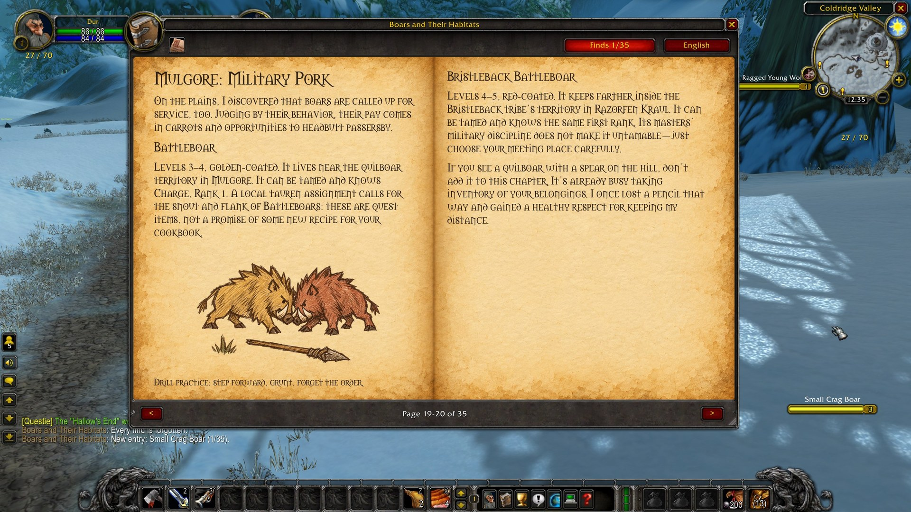
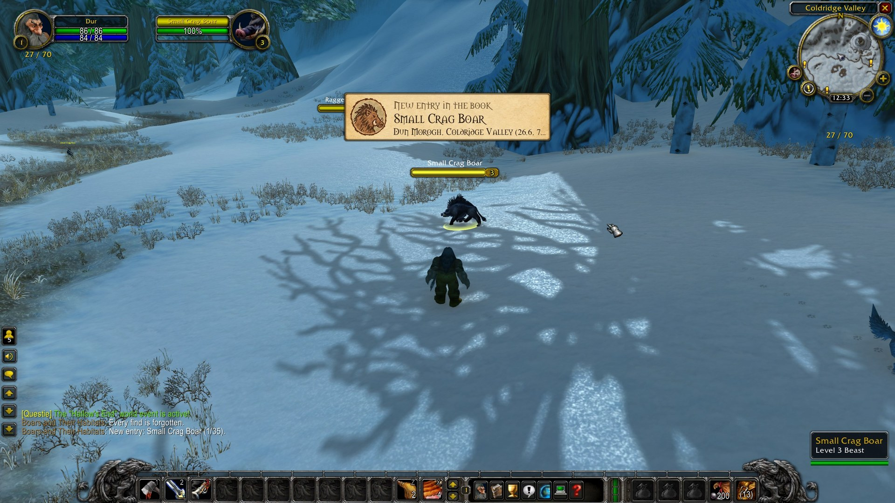
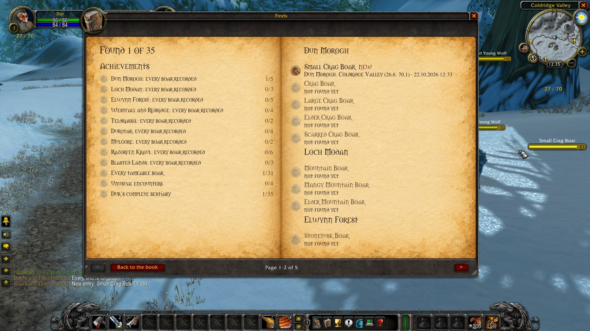
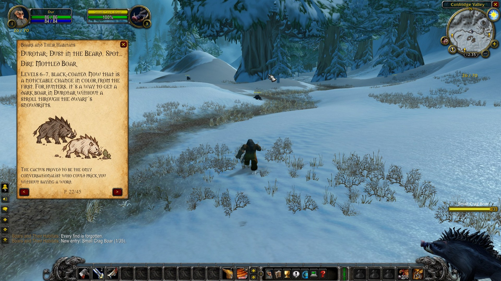

# Boars Book

**An illustrated in-game book for World of Warcraft Classic Era, and a hunt for every boar in it.**

Dur Blackbeard, a dwarf hunter with more enthusiasm than drawing skill, set out across both continents to meet every
boar a hunter can tame. Boars Book is his travel bestiary: where each kind lives, which coats are rare, how to tame
them, and a few recipes from beside the cooking pot — 14 chapters and 15 sketches on parchment, in English and Russian.

## What does it do?

- **A real book.** Two pages side by side on parchment, a page turn sound, the arrows or the mouse wheel to read on.
  In a narrow window it becomes a single page. Your place is remembered.
- **Hunt the boars.** Target a boar from the book anywhere in the world and Dur writes it down: a quiet quill sound,
  an achievement on parchment, and a seal next to its name in the book with when and where you found it.
- **Finds.** All 35 boars by region, region achievements and Dur's complete bestiary. The Finds button glows while
  something new is waiting.
- **Page windows.** Open any page in a small window over the book — as many as you like, each turning its own pages,
  to compare two chapters side by side.
- **English and Russian.** The language follows your game client and can be switched for the session.
- **A boar icon on the minimap.** Left click opens the book, right click opens a page window.

## Installation

**[Get Boars Book on CurseForge](https://www.curseforge.com/wow/addons/boars-book)**: install and update it with the
CurseForge app or any addon manager that uses CurseForge.

Or by hand: download `BoarsBook-<version>-classic.zip` from the
[latest release](https://github.com/ReSenpai/boars-book/releases/latest) and unpack it into
`World of Warcraft\_classic_era_\Interface\AddOns`, so that you get `Interface\AddOns\BoarsBook\BoarsBook.toc`.

Either way, restart the game completely (not just `/reload`) the first time, so it loads the book's pictures.

## A closer look

### Finding a boar

Target a boar from the book — a click or Tab is enough. Click the achievement to open the book on its chapter.

### Finds

Every boar of the book, found or not, and the achievements for whole regions. It turns pages like the book.

### Page windows

A page next to the game world, in its own small window. It keeps its page, moves and resizes.

## Commands

| Command | What it does |
|---|---|
| `/boars` | open or close the book |
| `/boars window` | open one more page window |
| `/boars found` | how many boars you have found |
| `/boars lang [ru\|en]` | switch the language for this session |
| `/boars font 18` | text size, 14–24 |
| `/boars minimap` | hide or show the minimap icon |
| `/boars help` | all commands |

## Compatibility

World of Warcraft Classic Era 1.15 (interface 11509), any game language. The boars and facts are those of Classic
Era; the book was written for it.

## Feedback

Found a bug, a wrong fact or a boar that will not count? [Open an issue](https://github.com/ReSenpai/boars-book/issues).
The boar's name and the zone help a lot.

## ☕ Support the project

Boars Book is free and open source, licensed under GPL-3.0. If it made your travels a little warmer and you would like
to support further work, you can donate voluntarily:

**[☕ Support on Boosty](https://boosty.to/resenpai)**

Support is voluntary. It does not unlock anything in the addon.

## Privacy

The addon keeps your reading place, window positions and finds in its own saved variables (`BoarsBookDB`,
`BoarsBookCharacterDB`) on your computer. It sends nothing anywhere: no messages to other players, no network.

Unofficial fan project, not affiliated with or endorsed by Blizzard Entertainment. World of Warcraft and Warcraft are
trademarks of Blizzard Entertainment, Inc.

## License

Boars Book is free software, released under the [GNU General Public License v3.0 or later](LICENSE): the code, the
text of the book and its pictures. You may use, study, share and change it; if you distribute a modified version, it
must stay under the GPL with its source available. Copyright (C) 2026 ReSenpai.

The name "Boars Book" and its boar medallion are not covered by the license: forks need their own name and emblem.
See [NOTICE](NOTICE).

## Contributing

See [CONTRIBUTING.md](CONTRIBUTING.md) — fixes to the text, translations and bug reports are welcome. Changes between
versions are listed in [CHANGELOG.md](CHANGELOG.md).

---

# Boars Book — по-русски

**Иллюстрированная книга для World of Warcraft Classic Era и охота за каждым кабаном из неё.**

Дворф-охотник Дур Чёрнобород рисует хуже, чем охотится. Он обошёл оба материка, чтобы встретить каждого кабана,
которого можно приручить. Это его путевой бестиарий: где живёт каждая разновидность, какие масти редки, как приручать
и что варить у котелка. 14 глав и 15 зарисовок на пергаменте, на русском и английском.

- **Настоящая книга:** разворот на пергаменте, шелест страниц, стрелки или колесо мыши. В узком окне — одна страница.
  Место чтения запоминается.
- **Охота за кабанами:** выделите в игре кабана из книги, и Дур запишет находку. Прозвучит перо, появится ачивка,
  а у имени кабана в книге — печать с датой и местом.
- **Находки:** все 35 кабанов по регионам и достижения за регионы. Кнопка «Находки» светится, когда есть новое.
- **Окна-страницы:** любую страницу можно открыть в маленьком окне поверх книги. Окон сколько угодно, каждое
  листается само — удобно сравнивать главы.
- **Язык** берётся из клиента: русский клиент — русский, любой другой — английский. Кнопкой над страницами его можно
  переключить до выхода из игры.
- **Значок кабана у миникарты:** левый клик — книга, правый — окно-страница.

**Установка:** [Boars Book на CurseForge](https://www.curseforge.com/wow/addons/boars-book) — через приложение
CurseForge или любой менеджер аддонов. Или вручную: скачайте `BoarsBook-<версия>-classic.zip` из
[релизов](https://github.com/ReSenpai/boars-book/releases/latest) и распакуйте в
`World of Warcraft\_classic_era_\Interface\AddOns`. В первый раз полностью перезапустите игру.

**Команды:** `/boars` — книга, `/boars window` — окно-страница, `/boars found` — сколько найдено,
`/boars lang ru|en` — язык, `/boars font 18` — размер текста, `/boars minimap` — значок, `/boars help` — все команды.

Неофициальный фан-проект, не связан с Blizzard Entertainment. Лицензия — GPL-3.0 или новее.
